# Problem 1: Building Castle In The Cloud

A high-level AWS design for a spot crypto exchange, modelled on the core of Binance. 500 requests/s with a p99 under 100 ms is not a lot of load, so most of the effort here goes into availability, predictable latency and cost. The platform has to survive losing a server, or a whole Availability Zone, without losing an order it has already accepted.

## Scope

In scope:
- Spot trading: placing and cancelling orders, and the matching engine.
- Account balances and a ledger.
- Real-time market data and order updates over WebSocket.
- User login with MFA, and API keys for trading bots.

Out of scope, each a design of its own: blockchain deposits and withdrawals, KYC, futures and margin, P2P, the admin back office.

## Assumptions

1. 500 requests/s is the REST API load (orders, cancels, queries). WebSocket pushes are counted separately.
2. The p99 < 100 ms target applies to placing an order, measured inside AWS. Fills reach the client afterwards over WebSocket.
3. The primary region is `ap-southeast-1` (Singapore). `ap-northeast-1` (Tokyo) is used only for disaster recovery.
4. A short trading halt is acceptable during a regional failover.
5. The team has Kubernetes experience. Without it I would pick ECS instead (see [why EKS](#compute-amazon-eks)).
6. Prices come from the AWS Pricing Calculator for `ap-southeast-1`, at a steady 500 requests/s (see [Capacity and cost](#capacity-and-cost)).

## Architecture

The editable source is [`chart/architecture.drawio`](chart/architecture.drawio), which has three pages. The images below are exported from it.

Page 1 shows where everything runs, across three AZs:

Page 2 shows how orders and market data move between services. The red path is order placement, which the latency target covers:

Page 3, the EKS add-ons, is under [Cluster platform](#cluster-platform).

### Components

| Component | Role |
|---|---|
| `order-api` | Accepts orders and cancels, reserves the funds, and puts the order on the event stream |
| `account-api` | Balances, order history and API keys |
| `matching-engine` | Matches buy and sell orders for a group of markets |
| `settlement` | Updates balances and the ledger after each trade |
| `market-data` | Builds the order book, trade and ticker feeds |
| `ws-gateway` | Pushes market data and order updates to clients over WebSocket |

### How a request flows

1. Client traffic enters through CloudFront and WAF, then the ALB, and reaches the API pods on EKS.
2. `order-api` records the order and reserves funds in Aurora, writes the order to MSK, and replies. This is the part the 100 ms target covers.
3. The matching engine reads orders from MSK and writes trades back to MSK.
4. `settlement` applies trades to balances in Aurora. `market-data` updates the market feeds in Valkey.
5. `ws-gateway` pushes the updates to clients.

MSK is the durable log. A consumer that fails resumes from its last committed offset, so an accepted order is never lost.

### The order path

Step 2 writes to two systems, Aurora and MSK, and either write can fail after the other has succeeded. If Aurora commits and the MSK write fails, funds stay reserved for an order the engine never sees. To close that gap, `order-api` writes the order, the fund reservation and an outbox row in one Aurora transaction, then produces to MSK directly and marks the row sent. A small relay republishes any outbox row still unsent after a second. Each order carries an ID generated before the transaction, and the matching engine drops IDs it has already seen, so a relay retry never creates a duplicate order. The client normally gets its reply once MSK acknowledges. If that takes longer than 50 ms, `order-api` replies anyway, since the order is already committed, and leaves the publish to the relay.

Rough latency budget for that path, inside the region:

| Step | Typical | Notes |
|---|---|---|
| ALB to pod | 1–2 ms | |
| Auth, validation, risk checks in `order-api` | 1–3 ms | API key and limits cached in memory and Valkey |
| Aurora transaction (reserve funds, insert order and outbox row) | 3–8 ms | Commit waits for a storage quorum across 3 AZs |
| MSK produce, `acks=all`, `min.insync.replicas=2` | 5–10 ms | One cross-AZ round trip |
| **Total** | **10–25 ms** | |

That leaves plenty of room under 100 ms. The p99 risks are GC pauses and row-lock contention on very active accounts, so the alerts below watch order latency per stage, not only end to end.

## Service choices and alternatives

### Compute: Amazon EKS

EKS, with Karpenter for the general node pool and a fixed-size node group for matching. I also looked at ECS on Fargate, ECS on EC2, and plain EC2 Auto Scaling groups.

For a handful of services, ECS on Fargate is less to operate, and if the team didn't know Kubernetes I'd pick it. I went with EKS because the team does know it, and because the matching engine needs its own compute-optimised nodes with reserved CPU cores to keep latency predictable, which Fargate can't give. Helm, Argo CD, KEDA and Prometheus also work on it without extra glue. The cost is $73/month for the control plane and a cluster upgrade about once a year.

There are two node pools:
- `general` runs the stateless services. Karpenter adds and removes Graviton (m7g) nodes across 3 AZs, Spot on top of an On-Demand base.
- `matching` is a fixed group of On-Demand c7i nodes reserved for the matching engine, never interrupted by Spot or moved around by autoscaling.

#### Cluster platform

These add-ons run in the cluster and manage the AWS services around it:

| Concern | How it works |
|---|---|
| Deployment | Argo CD syncs Helm charts and manifests from Git. The DR cluster tracks the same repository. The build and image promotion pipeline is out of scope. |
| Ingress | The AWS Load Balancer Controller manages the ALB from Ingress resources and registers pod IPs as targets. One ALB serves both REST and WebSocket. |
| Scaling | HPA scales stateless services on CPU and requests per second. KEDA scales Kafka consumers on consumer lag. Karpenter adds nodes when pods can't be scheduled. |
| Pod access to AWS | EKS Pod Identity gives each service its own IAM role, with short-lived credentials and no access keys. |
| Secrets | External Secrets Operator syncs Secrets Manager values into Kubernetes Secrets and picks up rotations. |
| Observability | The ADOT collector sends metrics to Amazon Managed Prometheus, traces to X-Ray and logs to CloudWatch Logs. Dashboards are in Amazon Managed Grafana. |

Images live in ECR with scan-on-push.

### Matching engine

You can't scale the matching engine by adding copies, because each market needs a single ordering of events. Markets are split into groups, and each group runs as one active instance plus a hot standby in another AZ. Both consume the same ordered stream from MSK, so the standby's book is always current and it can take over in seconds. Snapshots to S3 let a fresh instance start without replaying the whole topic.

Two engines writing trades for the same market would be a disaster, so only one may ever be active. A Kubernetes Lease decides which one. As a second guard, both instances in a group use the same Kafka transactional ID: when the standby takes over and starts its producer, the broker bumps the epoch and rejects any further writes from the old one, even if it hasn't noticed it lost the lease.

At 500 requests/s one instance is nearly idle. The groups exist to limit how many markets a single failure affects.

### Event log: Amazon MSK

MSK provisioned, 3 brokers across 3 AZs, replication factor 3. Kafka keeps orders in sequence per market, can replay history to rebuild state, and has low latency inside a region. The alternatives each fall short somewhere:

- Kinesis Data Streams has higher and less predictable write latency.
- SQS FIFO can't replay messages.
- MSK Serverless has partition limits and costs more at constant load.
- Self-managed Kafka on EKS saves a little money and hands broker operations to the team.

### Database: Aurora PostgreSQL

Aurora PostgreSQL I/O-Optimized, one writer and one reader in different AZs. Balances and the ledger need multi-row transactions, and finance and audit need ad-hoc SQL. DynamoDB has transactions but is awkward for that kind of querying. Over plain RDS PostgreSQL Multi-AZ, Aurora gives faster failover (usually under 30 s), storage replicated across three AZs, read replicas in minutes, and Global Database for DR.

### Cache and fan-out: ElastiCache for Valkey

ElastiCache for Valkey, one primary and two replicas across 3 AZs. It holds rate limits, order book snapshots for fast reads, and the pub/sub channels that feed `ws-gateway`. All of it can be rebuilt from MSK or Aurora, so MemoryDB's durability isn't needed. Valkey is compatible with Redis OSS and about 20% cheaper on ElastiCache.

### Edge and ingress

| Service | Why | Alternatives considered |
|---|---|---|
| Route 53 | DNS, plus health-check failover records for DR | Third-party DNS |
| CloudFront | Serves the web app from S3, and terminates TLS close to users for API and WebSocket traffic, which cuts connection time for users far from Singapore | Flat-rate CloudFront plan; Global Accelerator; exposing the ALB directly |
| AWS WAF | Managed rule groups, per-IP rate limits, geo restrictions | Filtering in the application only |
| Shield Standard | Free DDoS protection on CloudFront and Route 53 | Shield Advanced, worth it once revenue depends on uptime |
| ALB | Routes HTTP and long-lived WebSocket connections to pods; only accepts traffic from CloudFront | API Gateway: more latency, higher per-request cost at constant load, WebSocket connections capped at 2 hours. NLB: pushes TLS and HTTP routing into the pods. |
| Cognito | Sign-up and login with MFA; issues the tokens the APIs check | Self-built identity service; Auth0 |

### Observability

The ADOT collector on each node ships metrics to Managed Prometheus, traces to X-Ray and logs to CloudWatch Logs, with dashboards in Managed Grafana. I picked managed Prometheus over CloudWatch metrics alone because Kubernetes tooling expects Prometheus, and over self-hosting because a highly available Prometheus is a lot to run. The alerts that matter most are order latency per stage, MSK consumer lag, matching engine failovers and Aurora replica lag.

## High availability and failure handling

| Failure | What happens | User impact |
|---|---|---|
| Pod crash | Kubernetes restarts it, and the ALB stops sending it traffic | None |
| Node loss or Spot interruption | Karpenter replaces the capacity | None |
| Matching engine failure | The standby in another AZ takes the lease | Trades for that market group delayed about 5 s; orders are still accepted |
| Aurora writer failure | Aurora promotes the reader in another AZ | Order placement unavailable for up to about 30 s; clients retry |
| MSK broker failure | Partitions are replicated across 3 AZs, so writes continue | None |
| Valkey primary failure | A replica is promoted in seconds | WebSocket clients reconnect |
| Loss of a whole AZ | Every tier already runs in the other two, and Karpenter adds capacity there | Up to about 30 s |
| Loss of the region | Failover to the DR region | Trading halted for the RTO |

DR is a warm standby in Tokyo. Aurora Global Database replicates the database (lag usually under 1 s), MSK Replicator copies the event streams, and S3 Cross-Region Replication copies the engine snapshots. A small EKS cluster runs there, deployed from the same Git repository by Argo CD.

Failover is a manual decision: halt trading, promote Tokyo, check the data is consistent, switch Route 53, reopen markets. The targets are an RPO of a few seconds and an RTO of about 30 minutes.

I didn't go active-active across regions. Each market needs one place where its orders are sequenced, and splitting that across regions would put cross-region latency on every order.

## Security

All nodes and data stores sit in private subnets. Only the ALB and NAT gateways are public, and the ALB accepts traffic only from CloudFront. Security groups are scoped per tier, and VPC endpoints keep AWS API traffic off the internet.

Everything uses TLS in transit, and KMS keys encrypt Aurora, MSK, Valkey, EBS and S3 at rest. Pods get AWS access through Pod Identity, never static keys. Database credentials live in Secrets Manager with rotation on. CloudTrail is enabled across the organisation. [Problem 5](../problem5/SOLUTION.md) goes further.

## Capacity and cost

All figures come from the AWS Pricing Calculator for `ap-southeast-1`, in two saved estimates that show every input:

- [On-demand estimate](https://calculator.aws/#/estimate?id=5f3d45618eefd88289f94740cd90235a2c57465b): $6,910.92/month
- [Reserved estimate](https://calculator.aws/#/estimate?id=e35e0929753526782fd5383e914d251094fd8c9c): $6,358.83/month, with 1-year no-upfront commitments on the parts that run all the time

Traffic is a steady 500 requests/s, about 1.31 billion requests a month, with capacity for a 3x burst.

| Item | Size | On-demand (USD/month) | Reserved (USD/month) |
|---|---|---|---|
| EKS control plane | 1 cluster | 73.00 | 73.00 |
| General node pool, base | 3 x m7g.large, 50 GB gp3 each. Reserved column: Compute Savings Plan | 237.78 | 180.84 |
| General node pool, Spot | 3 x m7g.large on average, at the calculator's 53% historical Spot discount | 119.39 | 119.39 |
| Matching node group | 4 x c7i.xlarge (2 market groups, active and standby), 50 GB gp3 each. Reserved column: EC2 Instance Savings Plan | 620.14 | 418.07 |
| MSK | 3 x kafka.m7g.large, 500 GB per broker (MSK has no reservations) | 738.45 | 738.45 |
| Aurora PostgreSQL | writer + reader, db.r7g.large, I/O-Optimized, 200 GB. Reserved column: Reserved Instances | 770.84 | 624.93 |
| ElastiCache for Valkey | 3 x cache.r7g.large (1 shard, 2 replicas). Reserved column: reserved nodes | 460.78 | 313.61 |
| ALB | 1 ALB, 500 requests/s, about 4 GB/hour processed | 47.60 | 47.60 |
| NAT and VPC endpoints | NAT in 3 AZs with 150 GB/month processed; 7 interface endpoints x 3 AZs | 339.35 | 339.35 |
| CloudFront | Pay-as-you-go, Asia Pacific edges: 1.31B HTTPS requests, about 5 TB out a month | 2,095.32 | 2,095.32 |
| AWS WAF | 1 web ACL, 5 custom rules, 4 managed rule groups, 1.31B requests | 802.40 | 802.40 |
| Route 53 | 2 hosted zones, 50M queries, 2 HTTPS health checks for DR failover | 23.00 | 23.00 |
| Managed Prometheus | 50k active series, 60 s scrape interval, 30-day retention | 216.22 | 216.22 |
| Managed Grafana | 5 editors, 10 viewers | 95.00 | 95.00 |
| CloudWatch | 100 GB/month of logs, 50 alarms | 75.45 | 75.45 |
| X-Ray | 1.31B requests, 1% trace sampling | 156.20 | 156.20 |
| Secrets Manager, KMS, ECR, S3 | 20 secrets, 5 keys, 30 GB of images, 500 GB in S3 | 40.00 | 40.00 |
| **Total, primary region** | | **6,910.92** | **6,358.83** |

Traffic, not compute, drives this bill. At a steady 500 requests/s the request-priced services (CloudFront, WAF, X-Ray) are about 45% of the total, more than all the compute together. If real traffic averages well below the peak these lines shrink with it: at an average of 150 requests/s the total is roughly $4,800.

CloudFront also sells flat-rate plans that bundle CDN, WAF, DDoS protection and Route 53. For 1.31B requests the 2B-request Premium plan is $3,500/month, about $600 more than pay-as-you-go CloudFront, WAF and Route 53 together ($2,921). I used pay-as-you-go. The flat rate makes sense if a predictable bill during a traffic spike or DDoS is worth $600 a month.

Reservations save $552/month (8%). Savings Plans cover the EC2 nodes, and Reserved Instances cover Aurora and ElastiCache. MSK has no reservation option, and Spot and the request-priced lines can't be discounted further. A 3-year or partial-upfront term would save more, but locks in today's sizing for that long.

Two quirks of the estimate: the calculator only takes NAT as one "Regional NAT gateway" active in 3 AZs, which costs the same as three zonal gateways. The interface endpoints cost more than NAT itself ($201 of the $339), and I kept them for security and to avoid NAT data charges as traffic grows.

Not included: cross-AZ data transfer inside the region, and the DR region, which adds roughly $1,200/month for an Aurora secondary, a smaller MSK cluster and a minimal EKS cluster.

The cost decisions that matter: Graviton for everything that isn't latency-critical, Spot only for stateless pods, VPC endpoints instead of NAT data charges, and a warm-standby DR region instead of a second full one.

## Scaling plan

One matching instance, three Kafka brokers and one Aurora writer can each handle about 10x the target. Each stage below names what hits its limit first.

**About 5,000 requests/s and more markets (10x).** The stateless tier scales by itself through HPA and Karpenter. More market groups mean more matching instances and a bigger matching node group. Topics should be created with spare partitions from day one, and the brokers moved to m7g.xlarge. The Aurora writer is the first real limit: move it to a larger instance, send reads to the readers, and add RDS Proxy for connection pooling.

**About 50,000 requests/s, institutional flow.** Take the database off the order path: keep balances in memory next to the matching engine and let Aurora become the downstream system of record. Shard Aurora by account, across clusters or with Aurora Limitless Database. Move history and analytics to S3 and query it with Athena. Split EKS by domain (trading, market data, accounts) so each can be upgraded and fail on its own. Serve WebSocket traffic from more regions, fed by MSK Replicator, and put Global Accelerator in front for a stable anycast endpoint.

**Beyond that, latency-sensitive market makers.** Run the matching engine on dedicated hosts in a cluster placement group. Offer market makers same-AZ access through PrivateLink, as Binance does in AWS Tokyo. Finally, split markets across regions so that no single region sequences every order.
