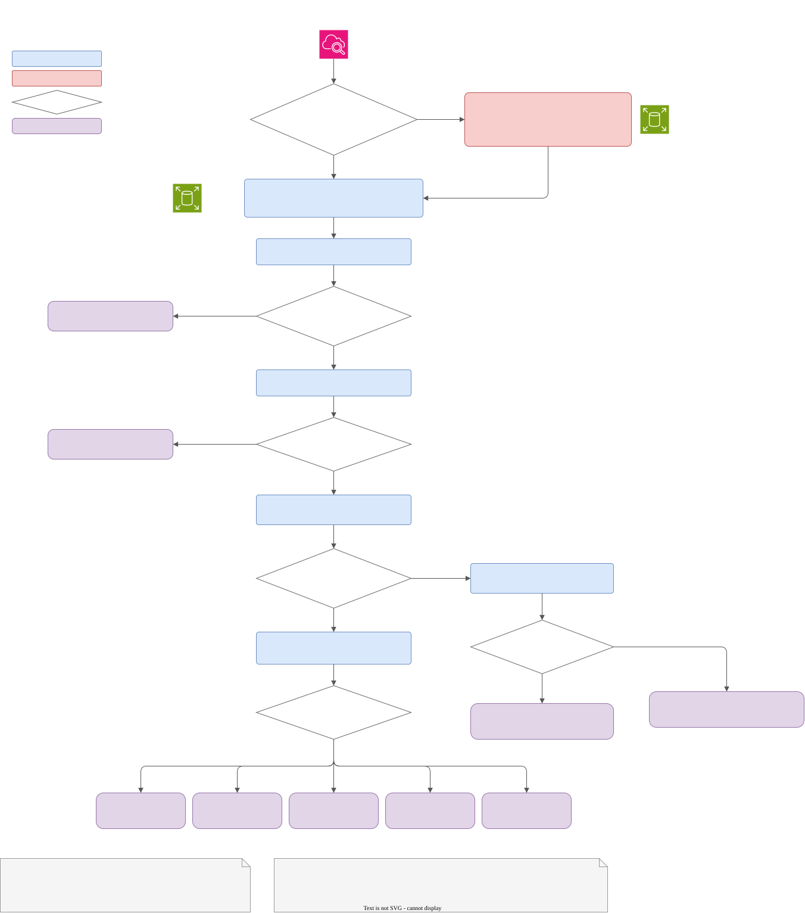

# Problem 2: Diagnose Me Doctor

An Ubuntu 24.04 VM with a 64 GB disk runs only NGINX as a load balancer, and monitoring shows it constantly at 99% disk usage. My order of work is: check whether users are hurting and buy some room if they are, keep a copy of the disk, find what is using the space, fix it, then stop it coming back.

## Assumptions

1. The task mentions "two production issues" but the scenario only describes one. I treat the full disk as the issue, and its effect on NGINX as part of it.
2. The VM is an EC2 instance with a 64 GB EBS root volume (ext4), monitored by the CloudWatch agent (`disk_used_percent`).
3. NGINX is the standard Ubuntu package with default paths: logs in `/var/log/nginx`, temp files in `/var/lib/nginx`, rotated daily by logrotate.
4. Nothing else is meant to run on the host, so anything large that isn't NGINX, the OS or logs is unexpected.

## Stabilise

ext4 reserves about 5% of the disk for root, and NGINX workers run as `www-data`. At 99% that reserve is all that's left, so NGINX gets "No space left on device" before the OS does. The first question is whether users are already affected: look for a rise in 5xx and for `No space left on device` in `/var/log/nginx/error.log`.

Before freeing anything, start an EBS snapshot (`aws ec2 create-snapshot`). It returns in seconds, the copy happens in the background, and it keeps the evidence that a cleanup would otherwise destroy. Then, if users are affected:

- Empty the live log rather than deleting it: `truncate -s 0 /var/log/nginx/access.log`. `rm` frees nothing while NGINX still holds the file open (cause B below).
- Delete what is safe to lose: old rotated logs (`*.gz`) and the apt cache (`apt-get clean`).
- If the cause still isn't clear, grow the EBS volume online with `aws ec2 modify-volume`, then `growpart` and `resize2fs` on the instance. No restart needed. This is a stopgap, because EBS volumes can't be shrunk again.

## Investigate

Restore the snapshot as a new volume and attach it read-only to a separate utility instance. I wouldn't boot a full copy of the server: a cloned NGINX host could start taking traffic, sending metrics or running cron jobs.

Some checks only work on the live host, so the work is split:

| Run on the live host | Run on the snapshot copy |
|---|---|
| Impact checks, `df`, `lsblk`, `df -i` | Full `du` / `find` scans |
| `df` vs `du` comparison, `lsof +L1` | Reading logs and the NGINX and logrotate config |
| | Trying a fix before applying it to production |

Causes B and D are files that were deleted but are still held open by NGINX. They exist only inside the running process, so the snapshot doesn't have them. The heavy scans run on the copy so a host that is already struggling doesn't get extra disk I/O.

The flowchart goes from the alert to a root cause. Source: [`chart/troubleshooting.drawio`](chart/troubleshooting.drawio).

| Check | What it tells you |
|---|---|
| `df -hT /` and `lsblk` | A filesystem much smaller than 64 GB was never grown after a volume resize (cause H). |
| `df -i /` | Inodes at 100% mean the disk is "full" because of the number of files, not their size (cause I). |
| `df` used vs `du -sx /` | `df` much higher than `du` means deleted files are still held open. `lsof +L1` shows which (causes B and D). |
| `du -xh --max-depth=2 /` | Which directory is using the space (causes A, C, E, F, G). |

The shape of the usage graph is a clue too. The disk sits *constantly* at 99% rather than climbing to 100%, which suggests something that grows until it hits a limit and stays there: a size-capped NGINX cache, journald at its cap, or logs kept for a fixed number of days. Usage that keeps climbing points to logs that are never rotated. Spikes that follow traffic point to NGINX temp files.

## Root causes, impact and recovery

| # | Root cause | Impact | Recovery | Prevention |
|---|---|---|---|---|
| A | NGINX logs too large: rotation broken, debug logging left on, or too many days kept for the traffic | Logs are lost, and once the disk is full requests start failing | Empty the live log, delete old rotated logs | Rotate by size as well as daily (`maxsize`), log level `warn`, ship logs to CloudWatch Logs |
| B | A deleted log still held open: someone ran `rm` on a live log, or logrotate didn't tell NGINX to reopen it | Same as A, and deleting files seems to do nothing | `nginx -s reopen` frees the space at once, with no downtime | Never `rm` live logs, keep the logrotate `postrotate` step, alert on a `df`/`du` gap |
| C | NGINX proxy cache with no size limit, or a limit close to the disk size | Everything else on the disk runs out of space. Clearing the cache briefly raises load on the upstreams | Delete cached files, set a limit | `max_size` and `min_free` on `proxy_cache_path`, or a separate volume for the cache |
| D | NGINX temp files from large responses to slow clients (up to 1 GB per request by default) or large uploads | Users are hit directly: large downloads are cut off while still showing `200 OK`, and uploads fail with 500 | Free space. The files go when the requests finish | Lower `proxy_max_temp_file_size`, set `client_max_body_size`, stream uploads |
| E | System logs: journald or syslog growing because a service is noisy or crash-looping | System logs are lost | `journalctl --vacuum-size=500M` | Set `SystemMaxUse`, fix the noisy service |
| F | Package leftovers: apt cache, old kernels, old snap revisions | OS updates fail part-way | `apt-get clean`, `apt-get autoremove --purge` | Regular cleanup, or rebuild hosts from fresh images |
| G | Crash dumps or files people left behind: core dumps, packet captures, backups in `/home` or `/tmp` | None until the disk fills | Copy anything needed to S3, delete the rest | Debug output goes to S3, not the server. Find out why the process crashed |
| H | Filesystem not grown after the EBS volume was enlarged | The server uses only part of the disk it pays for | `growpart` and `resize2fs` (online) | Make the grow step part of the resize procedure, set the size in infrastructure code |
| I | Inodes exhausted: millions of small files, usually cache entries | Same as a full disk | Delete the small files | Same as C, plus an inode usage alarm |

On a host that only runs NGINX, A and B are the most likely. D is the one that hurts users most: NGINX may already have sent `200 OK` when it runs out of space, so the response is silently cut short and nothing in the status codes shows it.

Page 2 of the chart lays out the same causes as check, analyse, recover and prevent steps:

## What a full disk does to NGINX

NGINX keeps serving, but access and error logs stop being written. Responses large enough to be buffered to disk get cut off mid-download, and large request bodies return 500. New responses aren't cached, so more traffic reaches the upstream services. On the host itself, security updates fail, and so does certificate renewal if it runs on the box.
