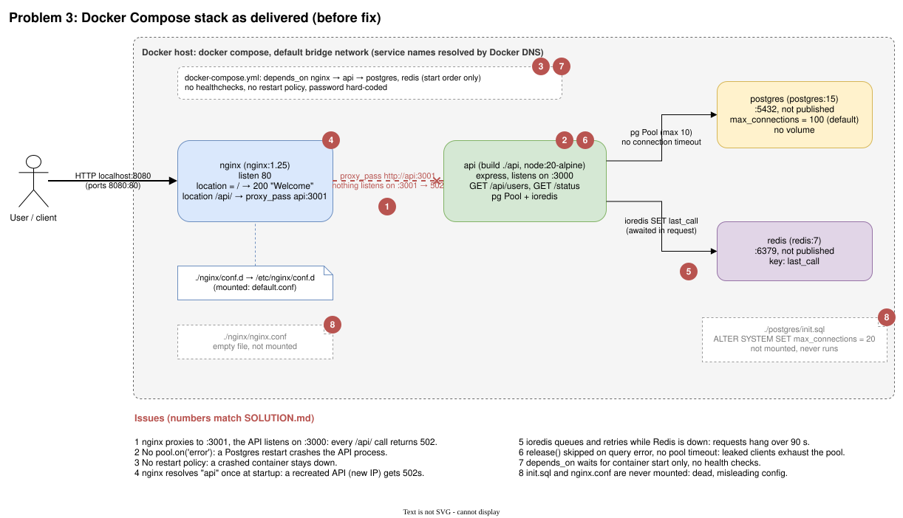

# Problem 3: Stabilizing the Docker Compose platform

The task is in [README.md](README.md) (titled "Problem 4" upstream). Users reported that the API was unreliable and sometimes unreachable. Through nginx it was actually never reachable, because nginx proxied to the wrong port. Fixing that only exposes the faults behind it, which make the API fail intermittently: it crashes on any database blip, nothing restarts it, nginx caches a stale container IP, and requests hang when Redis is down.

The repository files are left as delivered. Each section below gives the problem and the change that fixes it. I tested every fix on a working copy of the stack, with the results under [Verification](#verification).

## The stack as delivered

The four services, how they connect, and where each problem sits. The red numbers match the sections below. Source: [`chart/stack-before-fix.drawio`](chart/stack-before-fix.drawio).



## How I diagnosed it

I started the stack with `docker compose up --build` and requested the same endpoint from two sides: through nginx with `curl localhost:8080/api/users`, and from inside the API container with `docker compose exec api wget -qO- localhost:3000/api/users`. If the second works and the first doesn't, the fault is in the proxy, not the app.

Then I read the nginx and API logs, and broke each dependency on purpose while watching `docker compose ps`, the logs and request latency: restarted Postgres, stopped Redis, and recreated the API container so it got a new IP. Last, I read the code and config for faults a short test won't show, such as a connection leak, startup ordering and files that aren't used.

## Problems found, root causes and fixes

### 1. nginx proxies to the wrong port (API always unreachable)

Through nginx, `GET /api/users` returned 502. Inside the API container the same request returned 200. The nginx error log showed:

```
connect() failed (111: Connection refused) while connecting to upstream ... upstream: "http://172.20.0.4:3001/api/users"
```

`nginx/conf.d/default.conf` has `proxy_pass http://api:3001`, but the API listens on 3000. The fix points nginx at 3000, and the same block also fixes #4:

```nginx
resolver 127.0.0.11 valid=10s ipv6=off;   # Docker's embedded DNS

server {
    listen 80;
    set $api_upstream http://api:3000;

    location = / {
        return 200 "Welcome to the platform\n";
    }

    location /api/ {
        proxy_pass $api_upstream;          # a variable makes nginx re-resolve at runtime
        proxy_set_header Host $host;
        proxy_set_header X-Forwarded-For $proxy_add_x_forwarded_for;
        proxy_connect_timeout 2s;
        proxy_read_timeout 10s;
    }
}
```

### 2. A Postgres restart crashes the API

With direct requests working, I ran `docker compose restart postgres`. The API container exited, and Node printed an unhandled `error` event from a pg `Client`.

`pg.Pool` emits `error` when an idle client loses its connection. With no listener, Node treats it as an uncaught exception and exits, so any database restart, failover or network blip kills the API. One listener fixes it, and the pool reconnects on the next query:

```js
pool.on("error", (err) => console.error("Postgres idle client error:", err.message));
```

### 3. Nothing restarts a crashed container

After #2 the API stayed `Exited` in `docker compose ps`, because `docker-compose.yml` sets no `restart` policy. `restart: unless-stopped` on every service means the next crash, whether from #2, running out of memory or a plain bug, recovers by itself.

### 4. nginx keeps a stale API IP

I recreated the API container (`docker compose up -d --force-recreate --no-deps api`) while another container held its old address, and the API moved from `172.20.0.4` to `172.20.0.6`.

With a literal hostname in `proxy_pass`, nginx resolves `api` once at startup and keeps that IP until it restarts. After any API redeploy, nginx sends traffic to an address that no longer exists. To users that looks like random 502s, which is the "sometimes inaccessible" part of the report.

The `resolver 127.0.0.11` line and the variable in `proxy_pass` (shown in #1) make nginx re-resolve the name every 10 s. It also means nginx no longer refuses to start when `api` can't be resolved yet.

### 5. A Redis outage makes requests hang

With Redis stopped (`docker compose stop redis`), a direct request to `/api/users` hadn't answered after 90 seconds, and the logs filled with `[ioredis] Unhandled error event: ... ENOTFOUND redis`.

By default ioredis queues commands while disconnected and retries each one up to 20 times. The handler awaits `redis.set`, so every request waits on a dependency that isn't there. The `last_call` write is bookkeeping, so it shouldn't block or fail the response. Redis should fail fast and the write should be fire-and-forget:

```js
const redis = new Redis({
  host: process.env.REDIS_HOST,
  port: 6379,
  enableOfflineQueue: false,
  maxRetriesPerRequest: 1,
  connectTimeout: 2000,
  commandTimeout: 1000,
});
redis.on("error", (err) => console.error("Redis error:", err.message));

// in the handler, not awaited
redis.set("last_call", Date.now()).catch((err) => console.error("Redis write failed:", err.message));
```

### 6. A database connection leaks on query failure

Found by reading the code. The handler calls `pool.connect()`, and `db.release()` only runs on the success path, so every failed query leaks a client. After 10 leaks the pool (default size 10) is empty, and since `pg` has no connection timeout by default, every later request waits forever.

`pool.query()` always releases its client. Adding timeouts bounds the waits:

```js
const pool = new Pool({
  host: process.env.DB_HOST,
  user: process.env.DB_USER,
  password: process.env.DB_PASSWORD,
  database: process.env.DB_NAME,
  port: 5432,
  max: 10,
  connectionTimeoutMillis: 2000,
  statement_timeout: 5000,
});

app.get("/api/users", async (req, res) => {
  try {
    const result = await pool.query("SELECT NOW()");
    // redis write as in #5
    res.json({ ok: true, time: result.rows[0] });
  } catch (err) {
    console.error("Database query failed:", err.message);
    res.status(503).json({ ok: false, error: "database unavailable" });
  }
});
```

The `DB_*` variables come from #9.

### 7. Startup ordering

Found by reading the config. Plain `depends_on` only waits for a container to *start*, not to be ready, so the API can take traffic before Postgres accepts connections, and nginx can start before the API is listening. Health checks fix it:

```yaml
  api:
    depends_on:
      postgres: { condition: service_healthy }
      redis:    { condition: service_healthy }
    healthcheck:
      test: ["CMD", "wget", "-qO-", "http://127.0.0.1:3000/status"]
      interval: 10s
      retries: 3
    restart: unless-stopped

  postgres:
    healthcheck:
      test: ["CMD-SHELL", "pg_isready -U $${POSTGRES_USER}"]
      interval: 5s
      retries: 10
    restart: unless-stopped

  redis:
    healthcheck:
      test: ["CMD", "redis-cli", "ping"]
      interval: 5s
      retries: 10
    restart: unless-stopped
```

nginx waits on the API the same way, with `depends_on: api: { condition: service_healthy }`.

### 8. Unused and misleading config

`postgres/init.sql` sets `max_connections = 20`, but nothing mounts it, so it never runs and the live value is the default of 100. If someone did wire it in, 20 connections (3 reserved for superusers) would start failing with `too many clients` as soon as two API replicas each held a full pool of 10, which is another intermittent failure. Either delete it, or set the limit explicitly with `command: ["postgres", "-c", "max_connections=100"]` and size pools so that `replicas x pool max + headroom < max_connections`.

`nginx/nginx.conf` is empty and not mounted. Mounted as-is it would stop nginx from starting, since a valid config needs at least an `events {}` block. Delete it, or give it real content before mounting it.

### 9. Credentials hard-coded in the code and compose file

The database password `postgres` appears in `api/src/index.js` and in `docker-compose.yml`, and the app connects as the superuser. It isn't why the API is unstable, but it's the next thing a reviewer of this repo would flag. The values belong in `.env`, which the repo already ships empty and which should stay out of git, with a committed `.env.example` holding placeholders. Compose passes them on:

```yaml
  api:
    environment:
      DB_HOST: postgres
      DB_USER: ${POSTGRES_USER}
      DB_PASSWORD: ${POSTGRES_PASSWORD}
      DB_NAME: ${POSTGRES_DB}
      REDIS_HOST: redis

  postgres:
    environment:
      POSTGRES_USER: ${POSTGRES_USER}
      POSTGRES_PASSWORD: ${POSTGRES_PASSWORD}
      POSTGRES_DB: ${POSTGRES_DB}
```

Postgres also has no volume, so its data is lost on `docker compose down`. That's fine for a query that only reads `NOW()`, but a named volume would be the first change once the app stores anything.

## Verification

I applied the fixes to a working copy and re-ran each scenario:

| Scenario | Before | After |
|---|---|---|
| `GET /api/users` through nginx | 502 | 200 |
| Postgres restarted with open connections | API exits and stays down | 200, API restart count 0 |
| Postgres stopped | not tested (crashes on restart, see above) | 503 after 2 s, recovers on start |
| Redis stopped | hangs more than 90 s | 200 in about 4 ms |
| API recreated with a new IP | 502 until nginx restarts | 200 without touching nginx |
| API process killed | stays down | restarted by Docker, 200 |
| 2000 requests, 50 concurrent | n/a (502) | all 200 |

## Monitoring and alerts I would add

| Where | Signal | Alert | Would have caught |
|---|---|---|---|
| nginx | 5xx rate on `/api/` | Above 1% for 5 minutes | #1, #4 |
| nginx | Upstream response time p99 | Above 1 s | #5, #6 |
| nginx | `connect() failed` in the error log | Any occurrence | #1, #4, immediately |
| API | External synthetic check of `/api/users`, or a readiness endpoint that queries Postgres | Two failures in a row | #1, #2 |
| API | Container restart count | Any restart outside a deploy | #2 |
| Postgres | Connections in use vs `max_connections` | 80% | #8 |
| API | Pool connection timeouts | Any sustained rate | #6, early |
| Redis | Up/down, command errors | Warning only; the API works without it | #5 |

Logs should be collected centrally as structured JSON, with a request ID added by nginx, and alert on unhandled errors and process exits.

On AWS these become CloudWatch alarms on the ALB's `HTTPCode_Target_5XX_Count`, `TargetResponseTime` and `UnHealthyHostCount`, ECS service events, RDS `DatabaseConnections`, and CloudWatch Synthetics canaries, routed through SNS to on-call.

## Preventing this in production

In production I wouldn't run this on a single Compose host. ECS Fargate behind an ALB removes two of the problems outright: target groups track task IPs, so stale DNS (#4) can't happen, and ECS replaces crashed tasks (#3) while the ALB health check keeps traffic away from unhealthy ones. Postgres and Redis become RDS Multi-AZ, with RDS Proxy for connection pooling, and ElastiCache. Credentials move to Secrets Manager.

Most of the rest is cheap CI. `docker compose config` and `nginx -t` catch broken config. Hadolint and an image scan catch Dockerfile and dependency issues. A smoke test that runs `docker compose up --wait` and requests `/api/users` through the proxy would have caught the port mismatch on its own. To keep the port from drifting again, the app's listen port and the proxy target should come from the same variable.

The crash-on-error and hang-on-dependency bugs only show up when something fails, so staging should get the same treatment as the verification table above: restart the database, stop the cache, and check the API survives. Finally, pool sizes should be budgeted against `max_connections` per environment, with an alert before the limit is reached.
