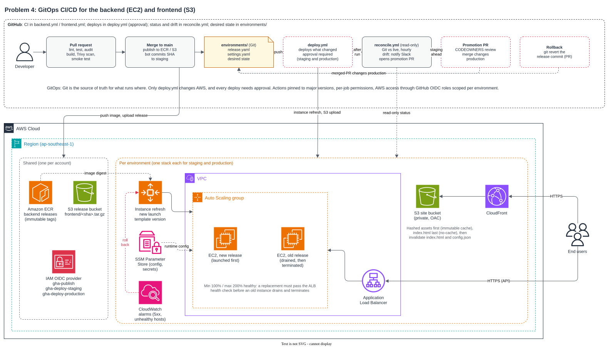
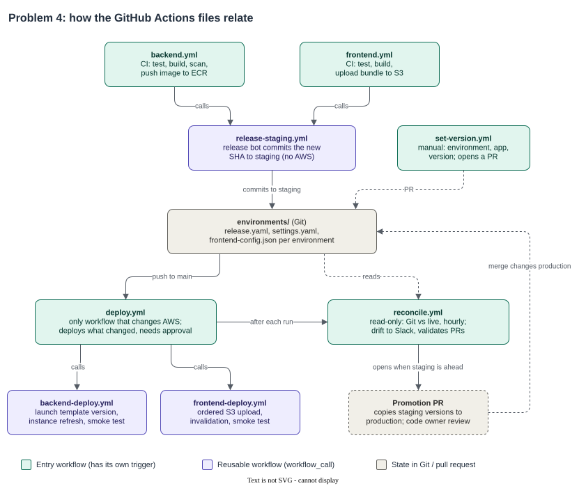

# Problem 4: Ship It Twice

Both apps deploy from Git. Each environment's desired state, meaning which commit of the backend and frontend should run in staging and in production, lives in the repository, so changing it is a commit and every deploy is approved by someone allowed to deploy. It's GitOps in the sense that Git is the source of truth. The deploys themselves are pushed from GitHub Actions, since there's no in-cluster agent to pull them.

In short: CI tests every pull request and publishes one immutable release from `main`. A release bot records each new release as staging's desired version. `deploy.yml` is the only workflow that touches AWS, and each of its deploy jobs waits for a reviewer. `reconcile.yml` is read-only: it compares what's live with what Git says, posts drift to Slack, and opens the pull request that promotes staging to production. Both deploys are zero-downtime.



Source: [`chart/pipelines.drawio`](chart/pipelines.drawio).

## What "production ready" means here

Git records what runs where. Every change to an environment is a reviewed commit, and reverting it is the rollback. Every deploy needs a reviewer, staging included, and production also needs a code owner to approve the promotion pull request.

`main` is always deployable: nothing merges without lint, tests and a dependency audit, and the backend image also gets a Trivy scan and a container smoke test. Each change is built once, and production runs the same artifact that ran in staging, with environment config from `environments/` applied at deploy time.

Deploys don't drop capacity and undo themselves. The backend replaces instances behind the ALB without losing healthy capacity and rolls back automatically on CloudWatch alarms. The frontend uploads in an order that never leaves a page pointing at missing files. If AWS and Git disagree, an hourly read-only check says so in Slack.

On access, deploys assume a per-environment IAM role through GitHub OIDC, and the status check uses a read-only role. No AWS keys are stored anywhere, and workflow permissions are granted per job. Dependabot keeps actions, npm packages and the base image current. Actions are referenced by version tag so Dependabot can bump them. Tags can be moved, though, as the 2025 `tj-actions/changed-files` compromise showed, so in a real repository I'd pin third-party actions such as `trivy-action` to a commit SHA, which Dependabot also updates.

## Assumptions

1. One repository holds both apps and the environment state, as `backend/`, `frontend/` and `environments/`. This folder stands in for its root. A separate config repository is the stricter GitOps split, but here it would add a repo and cross-repo tokens for little gain.
2. Both apps are Node 22 projects with `lint`, `test` and (for the frontend) `build` npm scripts.
3. The backend has a `Dockerfile` and a `/healthz` endpoint that returns 200 with `$APP_VERSION` in the body once the app is ready. The app finishes in-flight requests on SIGTERM.
4. The frontend builds to `dist/`, with content-hashed files in `dist/assets/`, and reads its API URL from `/config.json` at runtime.
5. "Deployed to EC2" means an Auto Scaling group of at least two instances behind an ALB. "Deployed to S3" means a private bucket behind CloudFront.
6. The AWS infrastructure already exists (VPC, ALB, Auto Scaling group, launch template, ECR, buckets, CloudFront, IAM roles). These pipelines deploy into it.
7. Staging and production are the two environments, in one AWS account. Staging is shared by QA and for demos, so a deploy there also needs a reviewer. If it's only used by developers, removing the required reviewer from the `staging` environment makes staging deploy on every merge, with no workflow change.

## Why it is built this way

The simplest version, deploying on merge to `main` with an environment approval, would work. I didn't stop there because then the only record of what's live is a list of workflow runs. Answering "what's in production?" means reading Actions history, a rollback means re-running an old job, and nobody notices when someone changes AWS by hand. With desired state in Git, each of those becomes a file, a revert, or a diff that `reconcile.yml` reports. That is what most of the extra workflows pay for. The release bot exists because pushes made with the default `GITHUB_TOKEN` don't trigger other workflows. `set-version.yml` is a convenience form for choosing a version; reverting a commit does the same job.

## Environment state

```
environments/
  staging/release.yaml           # desired backend.version and frontend.version (commit SHAs)
  staging/settings.yaml          # AWS resource identifiers and URLs (not secret)
  staging/frontend-config.json   # runtime config served as /config.json
  production/...                 # same files
```

Runtime secrets stay in SSM Parameter Store and the instances read them at boot. GitHub environments hold only the deploy role and the approval rules.

## How it works

The workflow files and how they call each other (source: [`chart/workflows.drawio`](chart/workflows.drawio)):



| File | Triggered by | Purpose |
|---|---|---|
| `backend.yml`, `frontend.yml` | pull request or push touching the app | CI; on `main`, publish the release and call `release-staging.yml` |
| `release-staging.yml` | called by the CI workflows | release bot commits the new SHA to staging's `release.yaml` |
| `deploy.yml` | push to `environments/`, or manual | the only workflow that changes AWS; each deploy job needs approval |
| `backend-deploy.yml`, `frontend-deploy.yml` | called by `deploy.yml` | deploy one app to one environment |
| `reconcile.yml` | hourly, after each deploy, manual, PRs to `environments/` | read-only status and drift alerts; opens the promotion PR |
| `set-version.yml` | manual: environment, app, version | checks the release exists, then opens a PR that sets that version |

### CI

On a pull request, `backend.yml` and `frontend.yml` lint, test, audit and build. The backend image is also scanned with Trivy and started as a container to check `/healthz`.

On a push to `main` the same checks run, then the release is published: the backend image goes to ECR as `backend:<sha>` with immutable tags, and the frontend bundle goes to `s3://<release-bucket>/frontend/<sha>.tar.gz`. `release-staging.yml` then commits the SHA to `environments/staging/release.yaml` using the release bot's GitHub App token. The bot only moves staging forward, so a slow build of an older commit can't overwrite a newer one.

### Deploy

`deploy.yml` runs on a push to `main` that changes a `release.yaml` or a `frontend-config.json`, or by hand for a chosen environment and app. A `plan` job diffs the desired state before and after the push and starts only the deploys that changed, so a staging change never asks anyone to approve production. Each deploy job targets its GitHub environment and waits for a reviewer. An approved deploy of a version that's already live does nothing.

The backend deploy (`backend-deploy.yml`) creates a launch template version whose user data ([`deploy/backend/user-data.sh`](deploy/backend/user-data.sh)) runs the release's image pinned by digest. It then starts an instance refresh with min 100% and max 200% healthy, so each new instance must pass the ALB health check before an old one is drained, and capacity never drops. `AutoRollback` is on, with the environment's CloudWatch alarms attached, so Auto Scaling restores the previous version by itself if something goes wrong. Last, a smoke test checks through the ALB that the new version is being served.

The frontend deploy (`frontend-deploy.yml`) adds the environment's `config.json`, uploads the hashed assets first with an immutable cache header, and uploads `index.html` last with `no-cache`. No visitor gets a page that points at files that aren't there yet. Old assets are kept, so open browser tabs keep working. It then invalidates `/index.html` and `/config.json` in CloudFront and runs a smoke test.

### Reconcile

`reconcile.yml` never deploys. It runs hourly, after every deploy run, and on demand, with a read-only role. It reads the live backend version from the description of the launch template version the Auto Scaling group runs, and the live frontend version from metadata on `index.html`.

Every run writes a table of environment, app, Git version, live version and status to the run summary. If anything is out of sync, it posts the list to Slack. That means a deploy is waiting for approval, failed or rolled back, or someone changed AWS by hand, and the fix always goes through Git or an approved deploy. When staging is in sync and runs versions production doesn't have, the release bot opens or updates a "Promote staging to production" pull request that links the commit range.

On pull requests that touch `environments/`, it checks that every version is a full commit SHA and that every settings and config file parses.

### Promotion, pinning a version, and rollback

CODEOWNERS requires a release approver on `environments/production/`. Merging the promotion PR triggers `deploy.yml`, and the production job then waits for a reviewer on the `production` environment.

To deploy a specific version, run `set-version.yml` from the Actions tab with the environment, the app and a commit SHA. It checks that the commit is on `main`, that the release was published (the image in ECR or the bundle in the release bucket, read with the read-only role), and that the version would actually change something. The release bot then opens a PR that sets the version in `environments/<env>/release.yaml`, and merging it deploys through `deploy.yml` with the usual approval. No workflow deploys a typed-in SHA directly.

To roll back, revert the commit that changed `environments/<env>/release.yaml`, or use `set-version.yml` to choose the earlier version, then get the PR merged and approve the deploy. The previous release is still in ECR or S3, so nothing is rebuilt.

During a backend rollout, old and new versions serve traffic at the same time, so schema changes have to stay backward compatible: add first, switch the code over, remove later.
