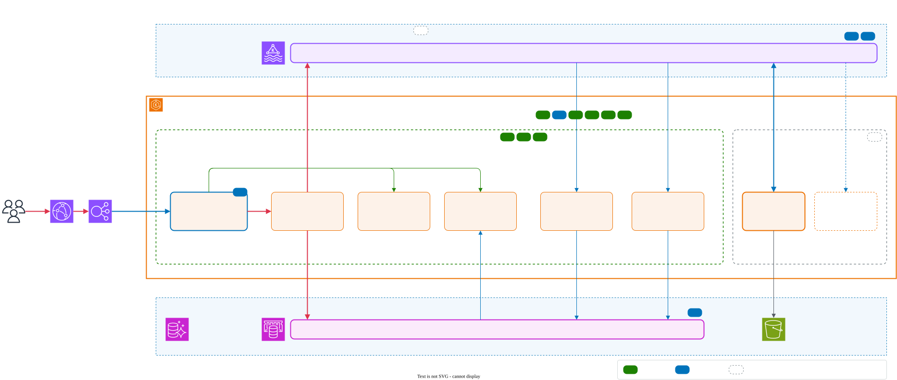
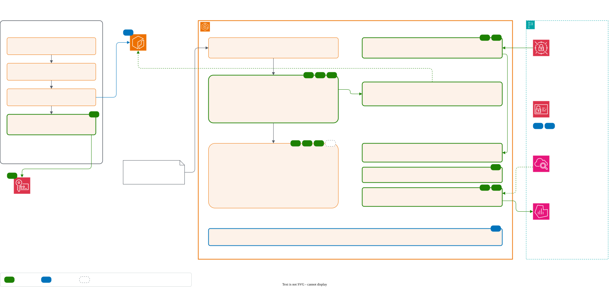

# Problem 5: Fortify The Castle

This pass secures the inside of the [Problem 1](../problem1/SOLUTION.md) EKS cluster and the two shared data planes every service talks through, MSK (Kafka) and Valkey.

I held myself to three constraints. First, no new AWS services: every control uses something Problem 1 already runs (IAM, KMS, Secrets Manager, CloudWatch, ECR) or an open-source add-on inside the cluster, so the bill and the list of things to operate barely change. Second, the platform team can apply every control through Terraform, Helm and Git, and where an application has to change I say so. Third, order placement must stay under 100 ms at p99, so any control on that path gets a latency estimate and a load-test gate.

The edge, Aurora, human access to AWS, the account structure and the wallet are left for later passes (see [Not in this pass](#not-in-this-pass)).

Every change has an ID (for example **K1**) used in the diagrams and tables, and is one of three types: **Changed** (something Problem 1 had now works differently), **Added** (a new control), or **Accepted** (a risk I looked at and chose to leave, with the reason).

## Why start inside the cluster

Problem 1's edge is reasonable: CloudFront, WAF, and an ALB that only accepts CloudFront. Inside the VPC, though, everything trusts everything. So I started from one question: what can an attacker do after getting code running in one pod, say through a library bug in `ws-gateway`, the most exposed service?

| From one compromised pod, today an attacker can... | Why it matters | After this pass |
|---|---|---|
| Write to the `trades` topic | Settlement credits balances from trades, so a fake trade creates money | Only the matching engine can write trades (**K1**) |
| Write to the `orders` topic | Skips the funds check in `order-api` | Only `order-api` can write orders (**K1**) |
| Publish to Valkey or delete keys | Fake prices and fills pushed to every client; rate limits wiped | `ws-gateway` can only read (**V1**) |
| Reach any pod and the internet | Lateral movement and data exfiltration | Default-deny networking, no internet (**N1**) |
| Steal the node's IAM role | Credentials usable from anywhere | Metadata service blocked for pods (**N2**) |
| Run any image, privileged, if it gets deploy access | Takes over the node | Restricted, signed images only (**P1–P3**) |
| Do all of this unseen | Found only when the ledger doesn't balance | Runtime alerts (**R1**) |

Services barely call each other directly. Almost everything flows through MSK, Valkey and Aurora, so whoever can write to them controls the exchange. That is why the data planes come first.

## Updated architecture

The editable source is [`chart/security.drawio`](chart/security.drawio). Green marks are **Added**, blue are **Changed**, grey dashed are **Accepted**.

**Secured request and data flow:** who can reach what, and with which identity.

**Cluster platform and supply chain:** how an image gets into the cluster, and what watches it at runtime.

### Summary of changes

| ID | Type | Change | Protects against |
|---|---|---|---|
| K1 | Changed | MSK uses IAM access control; each service may only read or write the topics it needs | Forged orders and trades |
| K2 | Changed | MSK accepts authenticated TLS only; topics are managed by Terraform, not apps | Bypassing K1; topics created or deleted by a service |
| V1 | Changed | Valkey requires TLS and a separate user per service, limited to its own keys, channels and commands | Fake prices or fills; rate limits wiped |
| N1 | Added | Default-deny network policies with a per-service allow-list | Lateral movement, exfiltration |
| N2 | Changed | Pods can't reach the instance metadata service | Theft of the node's IAM role |
| P1 | Added | Kubernetes Pod Security `restricted` profile in every app namespace | Privileged containers, root, host access |
| P2 | Added | Kyverno admission policies: our registry only, Argo CD as the only deployer, no casual `exec` | Unreviewed workloads, drift from Git |
| P3 | Added | CI signs every image with a KMS key; only signed images are admitted | Tampered or unknown images |
| M1 | Added | Istio ambient mesh with mutual TLS between workloads | Plaintext traffic, spoofed callers |
| M2 | Changed | The ALB sends traffic to an Istio ingress gateway instead of directly to pods | Unauthenticated hop into the cluster |
| M3 | Added | Deny-by-default service authorization; each service allows only named callers | A pod calling an API it shouldn't |
| M4 | Added | Mesh certificates chain to an offline root instead of a self-signed in-cluster one | Forged mesh identities |
| R1 | Added | Falco runtime detection and the EKS audit log, alerting through existing Grafana | A compromise going unnoticed |
| R2 | Added | A ready-made quarantine policy and runbook | Slow or destructive incident response |

## The changes, and why

### Kafka: only the right service writes orders and trades (K1, K2)

MSK switches to IAM access control. Each service already has its own IAM role through EKS Pod Identity, so topic permissions become IAM policy in Terraform, reviewed like any other change. `order-api` can only write `orders`, the matching engine can only read `orders` and write `trades`, and settlement and market data can only read `trades`. No application can create, delete or reconfigure topics.

I chose IAM over the alternatives because mutual TLS on MSK needs AWS Private CA (a new service), and SASL/SCRAM adds passwords to rotate plus a second permission system. IAM is also required by MSK Replicator, which Problem 1 already uses for DR.

The cost on the order path is nil: authentication happens once per connection. Applications need the MSK IAM client library and should reconnect with backoff, since MSK limits how fast new authenticated connections open.

### Valkey: per-service users with limits (V1)

Each service connects to Valkey as its own user, authenticated with short-lived IAM tokens, so there are no passwords to store. Each user is limited to its own key prefixes, channels and commands. The important one is `ws-gateway`: it can subscribe and read, but it can't publish a price or a fill, touch rate limits or flush data. Dangerous admin commands are blocked for everyone, and plaintext connections are refused.

Applications may need to adopt consistent key and channel prefixes if they don't use them already.

### Network isolation (N1, N2)

Every service gets its own namespace with a default-deny network policy, using the network policy support built into the EKS VPC CNI. Each service's Helm chart ships the allow rules it needs: DNS, its identity agent, and only the data stores it uses. Nothing gets internet egress. New namespaces get the default-deny policy automatically (P2), and new pods start denied until their policies apply, so there's no open window at startup.

Nodes require IMDSv2 with a hop limit of 1, so containers can't fetch the node's role credentials. Pods get AWS credentials from Pod Identity instead.

### Admission control and signed images (P1, P2, P3)

Kubernetes' built-in Pod Security Admission enforces the `restricted` profile on app namespaces: non-root, no privileges, no host access. Only the few platform namespaces that really need privileges are exempt.

Kyverno covers what Pod Security can't: images only from our ECR, pinned by digest; only Argo CD may change workloads, so Git stays the only way in; `exec` into pods only for a break-glass group; resource limits required; and the mesh and network defaults can't be switched off. I chose Kyverno over Gatekeeper because its policies are plain Kubernetes YAML and it verifies image signatures natively.

For P3, the CI release pipeline signs each image with cosign using a KMS key that only the `main`-branch release role can use. Third-party add-on images are mirrored, scanned and signed the same way, so the cluster has one trust root. Kyverno rejects anything unsigned. The [Problem 4](../problem4/SOLUTION.md) pipeline doesn't sign images yet, so this adds a signing step to its backend build.

Kyverno becomes a dependency for starting new pods: if it's down, new pods are rejected (running pods are unaffected). It runs with three replicas across AZs, never gates its own namespace or `kube-system`, and alerts on webhook errors. I'd rather accept a short deploy outage than run an unverified image.

### Service mesh (M1–M4)

Istio in ambient mode adds mutual TLS and workload identity between services. Ambient mode puts no proxy in each pod, adds less latency than sidecars, and works with the `restricted` pod profile.

Today the mesh does less than it sounds. Problem 1's services mostly talk through managed data stores outside the cluster, which the mesh can't cover (K1 and V1 protect those). The mesh protects the hop from the ALB into the cluster via an ingress gateway, metrics scraping, and every service-to-service call added as the platform grows. Authorization is deny-by-default, with each service allowing only named callers.

By default Istio keeps its root certificate in a Kubernetes Secret, so anyone who reads it can forge identities. Instead, an offline root signs an intermediate per cluster, stored in Secrets Manager.

The gateway hop adds an estimated 1–3 ms at p99, so this is the one control that must pass a load test before it ships.

### Runtime detection (R1, R2)

Falco runs on every node and also reads the EKS audit log. It alerts on things that should never happen with our distroless images and locked-down cluster: a shell in a container, unexpected outbound connections, attempts to reach the metadata service, writes to system paths, and humans reading secrets or exec-ing into pods. Alerts go through the existing Grafana alerting.

For response, a pre-made quarantine policy cuts off any pod given a specific label. The pod stays alive for forensics while a replacement takes its traffic. Falco detects but doesn't kill (X6), because a false positive that kills the matching engine halts trading.

## Latency

Most controls cost nothing per request: Kafka and Valkey authenticate at connect time, network policy checks take microseconds, and admission control only runs when pods start. The mesh is the exception, at an estimated 1–3 ms.

Each change runs in staging under the Problem 1 load profile and ships only if order placement p99 grows by less than **5 ms in total** across all controls.

## Priorities

**Refuse to launch without (tier 1).** These block the attacks that create or move money, and none of them add latency:
1. K1, K2: only the right services write orders and trades.
2. V1: `ws-gateway` can't publish to clients.
3. N1, N2: default-deny networking, no internet, no node credentials.
4. P1, P2, P3: restricted pods, Git as the only deployer, signed images only.
5. R1 core rules and R2: otherwise we'd learn of a breach from a ledger mismatch.

**Within weeks of launch (tier 2).** The Istio mesh (M1–M4). It's valuable, but tier 1 already covers most of what an attacker could reach, and the mesh changes the ingress path and adds latency, so it goes in deliberately behind the load-test gate. Also: enforcing fresh vulnerability-scan attestations, and widening Falco paging as false positives are tuned out.

**Deferred (tier 3).** The accepted risks below, each with a trigger that would bring it back.

## Rollout

Every control goes to staging first and is introduced in a non-blocking mode before being enforced: MSK and Valkey run old and new authentication side by side while services migrate one at a time; network policies log denials before default-deny is applied per namespace; Kyverno runs in audit mode for a week before enforcing; the mesh starts permissive before switching to strict; Falco sends to a quiet channel for two weeks before paging. The DR cluster tracks the same Git repository and Terraform, so it gets the same controls.

## Accepted risks and what I left out

| ID | Accepted risk | Why it's acceptable for now | What would change my mind |
|---|---|---|---|
| X1 | The matching engine is not in the mesh | It receives almost no in-cluster calls, and keeping Istio off its path means a mesh problem can't stop trading. N1, K1 and Falco still apply. | Something starts calling the engine directly |
| X2 | Data stores allow all nodes at the security group level, not individual pods | Per-pod security groups add complexity with Spot capacity; N1, K1 and V1 already restrict and authenticate each client | An audit requirement for per-service network isolation |
| X3 | The ALB doesn't verify the gateway's certificate | An ALB limitation; the hop is private and locked down | Not fixable with an ALB |
| X4 | AWS-managed add-on images aren't signed by us | They come from AWS-owned registries, allow-listed by account | AWS publishes verifiable signatures |
| X5 | Kafka messages aren't signed end to end | K1 controls who can write; signing would mainly guard against a compromised broker | More teams get write access, or regulation requires it |
| X6 | Falco detects but doesn't block | A false positive could halt trading; a human decides | Rules are accurate for a few months |
| X7 | No HTTP-level (L7) mesh policies | No service-to-service HTTP APIs exist yet | The first such API |
| X8 | The mesh doesn't cover MSK, Valkey or Aurora | Managed services outside the cluster; covered by K1 and V1 | Not applicable |

**New AWS services left out on purpose**, to revisit if that rule is relaxed: GuardDuty EKS Runtime Monitoring (instead of Falco), AWS Private CA (instead of the offline root, and enabling MSK mutual TLS), AWS Signer, Inspector for continuous image scanning, and Security Hub with Config for a single view of findings.

### Not in this pass

- **Aurora:** per-service IAM database users, least-privilege grants, an append-only ledger.
- **Edge:** WAF bot control, signed API requests, Shield Advanced.
- **Human access:** SSO, break-glass procedure, RBAC review.
- **Account structure:** separate production, logging and security accounts with SCPs.
- **Wallet, deposits and withdrawals:** out of scope since Problem 1, and the biggest risk for a real exchange.

## Unknowns and assumptions

| What I need | How I'd get it | What I assumed |
|---|---|---|
| Each service's Kafka and Valkey client libraries | Dependency review, asking teams | Maintained clients that support IAM authentication |
| Current latency headroom on order placement | Staging load test and traces | At least 10 ms under the 100 ms target |
| The real topics, consumer groups, keys and channels | MSK listing, service configs, code review | `orders` and `trades`, one consumer group per service, consistent key prefixes |
| Any direct service-to-service calls not in the diagram | X-Ray service map, VPC Flow Logs | Only gateway-to-API calls and metrics scraping |
| Team experience with Istio | Asking | None, which is another reason for ambient mode and tier 2 |
| Compliance requirements (for example MAS TRM) | Asking compliance | Nothing that mandates a specific tool |

## Cost

No new AWS services. The add-ons (Istio, Kyverno, Falco) need about three more general-purpose nodes, and audit and security logs add some CloudWatch volume. That comes to roughly **$270/month** in the primary region, about 4% on top of the [Problem 1 estimate](../problem1/SOLUTION.md#capacity-and-cost), plus about $80 for the DR cluster.
